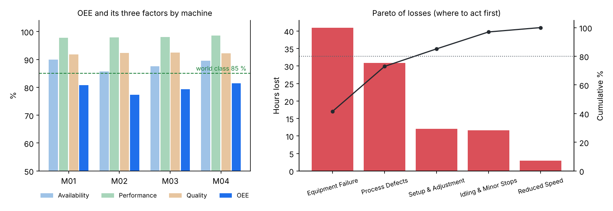

# OEE Dashboard: Lean Manufacturing Analytics

Turns a production event log (breakdowns, setups, micro-stops, scrap) into the KPI every plant manager watches, **Overall Equipment Effectiveness**, then decomposes the losses with the TPM *Six Big Losses* and ranks them in a Pareto so you know where to act first.

[](https://github.com/alaaeddinethr/oee-dashboard/actions/workflows/ci.yml)


## Why OEE

OEE = Availability × Performance × Quality. It answers one question: out of the time a machine was planned to produce, how much produced good parts at full speed? 85 % is the usual world-class reference. The gap is capacity a plant can recover without buying a single machine, and the loss breakdown tells you whether to work on maintenance, changeovers, micro-stops or scrap.

## Results on a simulated line

4 machines, 15 shifts (3 shifts a day for 5 days), 45 s ideal cycle time, 450 min of net planned time per shift. Reproduce with `python scripts/make_readme_figures.py`.



| Metric | Value |
|---|---|
| **OEE** | **79.7 %** |
| Availability | 88.2 % |
| Performance | 98.1 % |
| Quality | 92.2 % |
| MTBF / MTTR | 302 min / 23.9 min |
| Scrap rate | 7.8 % |

**Reading it as a plant engineer would:** the line is about 5 points below world class. Equipment failures (42 % of lost time) and scrap (31 %) make up three quarters of the losses, so the first levers are maintenance (preventive plans to raise MTBF) and process quality, well before changeover time (SMED) or micro-stops.

## How losses are classified

| OEE factor | TPM loss | Event type in the log |
|---|---|---|
| Availability | Equipment failure | `BREAKDOWN` |
| Availability | Setup & adjustment | `SETUP` |
| Performance | Idling & minor stops (< 5 min) | `MINOR_STOP` |
| Performance | Reduced speed | `SPEED_LOSS` |
| Quality | Process defects | scrapped parts |
| Quality | Reduced yield (start-up) | not modelled yet (0) |

Scheduled breaks (`BREAK`) are planned time, not a loss: they are excluded from planned production time once, and the unit tests check they are not counted twice.

## Project structure

```
src/
├── data/simulator.py        # production event generator (seeded, reproducible)
├── oee/
│   ├── calculator.py        # availability, performance, quality, OEE, MTBF/MTTR per shift
│   └── losses.py            # Six Big Losses decomposition
├── lean/
│   ├── pareto.py            # Pareto ranking, 80/20 cut-off
│   └── report.py            # shift reports, machine comparison, trends
└── dashboard/app.py         # Streamlit dashboard
scripts/make_readme_figures.py
tests/                       # 50 unit tests
```

## Run it

```bash
pip install -r requirements.txt
python src/data/simulator.py --shifts 15                       # writes data/production_events.csv
python src/oee/calculator.py --data data/production_events.csv # report per shift and machine
streamlit run src/dashboard/app.py                             # dashboard
pytest tests
```

To analyse a real line, export your event log to a CSV with the columns `timestamp, machine_id, event_type, duration_min, parts_produced, parts_good, parts_scrap, shift, operator` and pass it to `calculator.py --data`.

## References

- Nakajima, S. (1988). *Introduction to TPM: Total Productive Maintenance*. Productivity Press.
- Womack, J. P., Jones, D. T. (1996). *Lean Thinking*. Simon & Schuster.

---

Alaa Eddine Tahir, engineering student at Arts et Métiers. Built after an internship on an automotive assembly line at Stellantis Metz. [LinkedIn](https://linkedin.com/in/alaaeddine-tahir)
